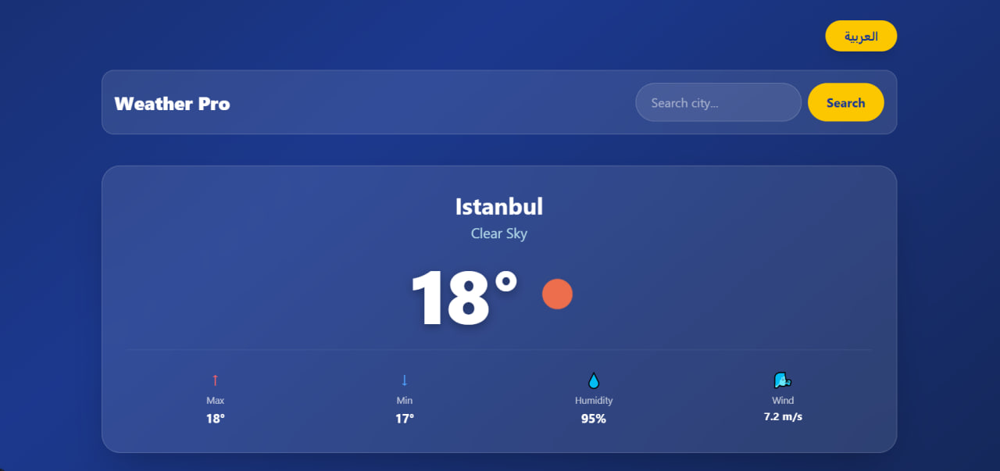
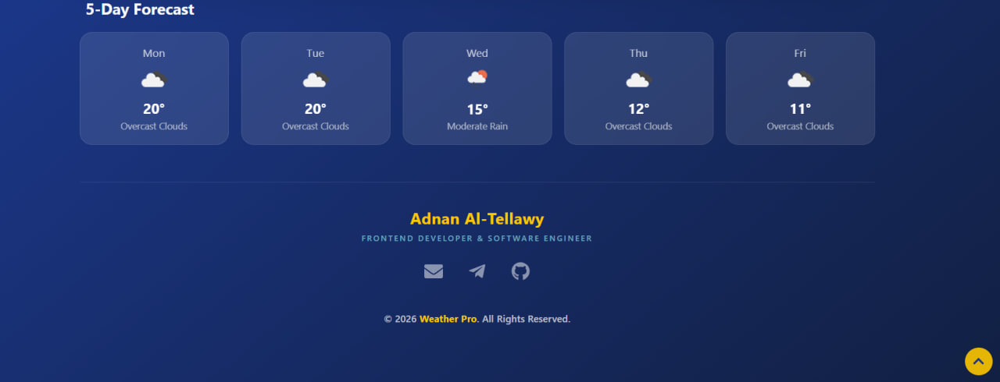

# Weather Pro

A weather web app that shows current conditions and a multi-day forecast for any city, with data fetched from the OpenWeatherMap API.

Live demo: https://adnan-weather-pro.netlify.app

## Screenshots

## Features

- Current temperature, wind speed, and humidity
- Multi-day forecast
- Search by city name
- Loading state while data is fetched
- Error handling for unknown cities and failed requests
- Arabic and English interface
- Responsive design

## Tech Stack

- [Next.js](https://nextjs.org/)
- [Tailwind CSS](https://tailwindcss.com/)
- [OpenWeatherMap API](https://openweathermap.org/api)
- Deployed on [Netlify](https://www.netlify.com/)

## Getting Started

1. Get a free API key from [OpenWeatherMap](https://openweathermap.org/api).
2. Clone the project and install dependencies:

git clone https://github.com/Adnan-AlTellawy/weather-pro.git
cd weather-pro
npm install
3. Create a .env.local file in the project root (see .env.local) and add your key:

NEXT_PUBLIC_WEATHER_KEY=your_api_key_here
4. Start the development server:

npm run dev
Then open http://localhost:3000 in your browser.

## Author

Adnan Jahed Al-Tellawy — Front-End Developer
[GitHub](https://github.com/Adnan-AlTellawy) · [LinkedIn](https://www.linkedin.com/in/adnan-altellawy-497500448) · [Portfolio](https://adnan-altellawy.netlify.app) · adnanaltellawy@gmail.com